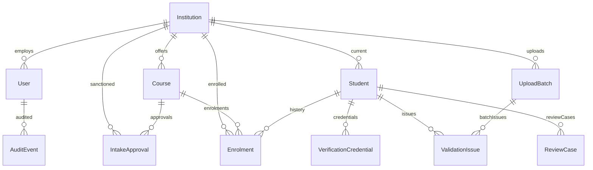

# APAARSetu — AICTE Student Data Management & Verification Platform
### Smart India Hackathon (SIH) Full-Stack Prototype

[](https://www.aicte-india.org/)
[](LICENSE)
[%20%2B%20Vite%20%2B%20TailwindCSS-38bdf8.svg)](https://react.dev/)
[](https://expressjs.com/)
[]()

---

## 📌 Executive Summary

**APAARSetu** is an enterprise-grade technical education governance platform built for the **All India Council for Technical Education (AICTE)**, Ministry of Education, Government of India. 

The platform bridges institutional student admission systems with national education databases through simulated **Automated Permanent Academic Account Registry (APAAR / One Nation One Student ID)** workflows, providing:
1. **Automated Admission Validation**: Prevents duplicate admissions, validates APAAR formats, and audits sanctioned seat compliance.
2. **Cross-Institution Duplicate Detection**: Detects and halts illegal concurrent active enrolments of the same student across multiple colleges.
3. **Approved Intake Monitoring**: Real-time tracking of regular vs. supernumerary quotas (TFW 5%, PMSSS, Foreign National, Kashmiri Migrants).
4. **Verifiable Academic Credentials**: Cryptographically signed student credentials with tamper detection and QR-code verification (strictly avoiding PII leakage in URLs).
5. **Adjudication & Audit Trail**: Role-based dispute resolution with an immutable audit log.

---

## 🛠️ Technology Stack

| Layer | Technologies |
| :--- | :--- |
| **Frontend** | React 18 (React JS / JSX), Vite, Tailwind CSS, Lucide React Icons |
| **Data Visualisation** | Recharts (Responsive bar charts, area trends, donut charts) |
| **Backend API** | Node.js (v24), Express.js (v4), TypeScript |
| **Database & ORM** | Prisma ORM with SQLite (zero-config local prototype) / PostgreSQL compatible |
| **Validation & Parsing** | Zod (strict API contract enforcement), PapaParse (CSV streaming engine) |
| **Cryptography & Trust** | Node.js `crypto` (HMAC-SHA256 digital signing), `qrcode` (Vector QR generator) |
| **Security** | Helmet (HTTP security headers), `express-rate-limit`, BCrypt (Salt rounds 10), JWT |

---

## 👥 Role-Based Access Control (RBAC) & Demo Credentials

The application includes a **1-Click Demo Evaluation Switcher** on the login page and top navigation bar for immediate evaluator access without manual typing.

| Role | Name | Email | Password | Scope & Responsibilities |
| :--- | :--- | :--- | :--- | :--- |
| **AICTE Admin** | Dr. Ramesh Chandra | `aicte.admin@aicte.gov.in` | `Admin@123` | **Apex National Level**: National analytics, cross-institution dispute adjudication, sanctioned intake approvals, full audit ledger. |
| **Institution Admin** | Prof. Rajesh K. Varma | `admin@iitd.ac.in` | `IITD@123` | **IIT Delhi (Code: 1-001)**: Scoped strictly to IIT Delhi students, CSV bulk upload, capacity management, and verifiable credential issuance. |
| **Institution Admin** | Prof. Sunita Deshpande | `admin@coep.ac.in` | `COEP@123` | **COEP Tech University (Code: 1-002)**: Scoped to COEP Pune, intake utilization, supernumerary tracking. |
| **Institution Admin** | Dr. Anand Kulkarni | `admin@vjti.ac.in` | `VJTI@123` | **VJTI Mumbai (Code: 1-003)**: Demonstrates cross-institution collision handling against IIT Delhi. |
| **Institution Admin** | Prof. Santosh Patil | `admin@gcekarad.ac.in`<br>*(alt: `contact@gcekarad.ac.in`)* | `Admin@123` | **GCEK Karad (Code: 1-20054321, AISHE: C-43120)**: Government College of Engineering Karad, student admissions, intake compliance & verification. |
| **Authorized Verifier** | Vikram Sengupta (TCS) | `verifier@tcs.com` | `Verifier@123` | **Corporate HR / Third-Party**: Public QR scanning, anti-tamper demonstration, credential status inspection. |

> **Quick Login Tip:** For any newly provisioned institution from the Onboarding portal, use the administrator email provided during creation (e.g. `admin@gcekarad.ac.in`) with password `Admin@123`.

---

## 🎯 Key Features & Functional Modules

### 1. Automated Validation Engine
When batches or single records are submitted, the validation engine executes 8 distinct checks:
- **Missing APAAR Detection**: Flags records lacking an APAAR ID with a `MISSING_APAAR` advisory requiring post-admission DigiLocker sync.
- **Format Validation**: Strict 12-digit format check (`XXXX-XXXX-XXXX` or 12 numeric digits). Identifiers are clearly marked as *synthetic test identifiers*.
- **In-File Duplicate Check**: Detects duplicate APAAR IDs or duplicate roll numbers in the same upload batch.
- **In-Database Duplicate Check**: Checks if the student already has an active enrolment in the same institution.
- **🚨 Potential Cross-Institution Duplicate Enrolment Detection**: Cross-references all active enrolments nationally. If student APAAR `2026-9090-1122` is already enrolled at IIT Delhi and is submitted at VJTI Mumbai, the engine immediately halts regular admission, marks the record `FLAGGED`, and creates an official `ReviewCase`.
- **Approved Intake Monitoring**: Tracks regular admissions against approved intake. Flags `INTAKE_EXCEEDED` warnings or errors if regular quota overflows.
- **Supernumerary Quota Isolation**: Correctly segregates Tuition Fee Waiver (TFW 5%), PMSSS, J&K Migrant, and Foreign National seats so they never wrongfully deplete regular approved seats.

### 2. Bulk CSV Upload & Preview
- Downloadable official standardized CSV template (`/api/upload/template`).
- Drag-and-drop file upload with live client & server preview.
- Row-by-row diagnostics table displaying: Row #, Student Name, APAAR, Diagnostic Rule, Severity (Error, Warning, Info), and exact reason.
- Allows partial commit: Accepted compliant rows are saved while invalid rows are isolated for rectification.

### 3. AICTE Apex Analytics Dashboard
- **KPI Metrics**: Total Accredited Institutions, Total Enrolled Students, Validated Clean Records, Flagged Collisions, Active Review Cases, and Verifiable Credentials.
- **Interactive Recharts**:
  - *Course-Wise Approved Regular Intake vs. Actual Enrolment vs. Supernumerary Quota*.
  - *State-Wise Technical Institutions Distribution*.
  - *Category & Demographic Allocation (GENERAL, OBC, SC, ST, EWS, TFW, PMSSS)*.
- Real-time Alert Feed: Immediate links to resolve pending cross-institution collisions.

### 4. Cross-Institution Review & Adjudication Workflow
- Dedicated dispute queue for suspicious records (`ReviewCases`).
- **Side-by-Side College Comparison**: Displays Institution A (Primary) vs. Institution B (Conflicting) side-by-side with course, roll number, and admission timestamps.
- Adjudication status transitions: `UNDER_REVIEW` ➔ `RESOLVED`, `REQUIRING_CORRECTION`, or `REJECTED`.
- Mandatory reviewer remarks and immutable audit trail.

### 5. Verifiable Academic Credentials & Anti-Tamper Engine
- Generates a unique test reference: `APAAR-CRD-YYYY-XXXX`.
- Digitally signs payload using a server-held private key (HMAC-SHA256).
- High-density QR code pointing to public verification endpoint:
  ```
  http://localhost:5173/verify?ref=APAAR-CRD-2026-IITD-001&sig=...
  ```
  *(Note: Zero PII or raw APAAR identifiers in the QR URL).*
- **Interactive Anti-Tamper Demo**: Evaluators can modify the student's name or course and execute a live tamper check. The cryptographic check immediately fails and displays:
  > *"SUCCESS: Cryptographic Tamper Detected! HMAC-SHA256 signature verification failed immediately."*
- Supports real-time credential revocation with revocation reason logging.

---

## 🗄️ Database Architecture (11 Prisma Models)



1. **`User`**: Administrators and verifiers with role, institution linkage, and bcrypt password hash.
2. **`Institution`**: AICTE-approved colleges with AISHE code, state, city, and contact details.
3. **`Course`**: Academic programs (e.g. BT-CSE, BT-ECE, MT-AI) with degree level and duration.
4. **`IntakeApproval`**: Sanctioned regular capacity and supernumerary caps per course & academic year.
5. **`Student`**: Core student demographic record with synthetic APAAR ID, verification state, and category.
6. **`Enrolment`**: Historical and active enrolments with semester, roll number, supernumerary classification, and status (`ACTIVE`, `FLAGGED`, `TRANSFERRED`).
7. **`UploadBatch`**: CSV batch ledger tracking accepted, rejected, and warning counts.
8. **`ValidationIssue`**: Row-level diagnostic errors, warnings, and collision details.
9. **`ReviewCase`**: Dispute cases with primary and conflicting institution links, status, and reviewer remarks.
10. **`VerificationCredential`**: Cryptographically signed academic credentials with HMAC-SHA256 signature, QR data URL, and revocation ledger.
11. **`AuditEvent`**: Immutable security event trail logging user, IP, action, entity, and timestamp.

---

## ⚡ Quickstart & Installation Instructions

### Prerequisites
- **Node.js** (v18+ or v24+)
- **npm** (v9+)

### 1. Configure Environment Variables
Backend comes pre-configured with `.env`:
```ini
PORT=5000
NODE_ENV=development
DATABASE_URL="file:./dev.db"
JWT_SECRET="apaarsetu_hackathon_demo_jwt_secret_key_2026_super_secure"
CREDENTIAL_SIGNING_KEY="apaarsetu_aicte_credential_ed25519_demo_signing_key_9921"
CLIENT_URL="http://localhost:5173"
```
*(For production PostgreSQL, simply change `DATABASE_URL` to your PostgreSQL connection string and set `provider = "postgresql"` in `backend/prisma/schema.prisma`).*

### 2. Install Dependencies
```powershell
# Install backend dependencies
cd backend
npm install

# Install frontend dependencies
cd ../frontend
npm install
cd ..
```

### 3. Database Migration & Synthetic Seeding
```powershell
# Generate Prisma Client and push database schema
cd backend
npx prisma generate
npx prisma db push

# Seed realistic Indian institutions, courses, students, and test scenarios
npm run seed
cd ..
```

### 4. Run the Application
Open two terminal windows:

**Terminal 1 (Backend Server):**
```powershell
cd backend
npm run dev
# Server running at http://localhost:5000
```

**Terminal 2 (Frontend Client):**
```powershell
cd frontend
npm run dev
# Web App running at http://localhost:5173
```

---

## 🧪 Pre-Seeded Test Scenarios (Evaluation Guide)

1. **Test Cross-Institution Collision**:
   - Log in as **AICTE Admin** (`aicte.admin@aicte.gov.in` / `Admin@123`).
   - Notice the red collision alert banner on the dashboard.
   - Navigate to **Review Cases & Alerts** ➔ Inspect case `RC-2026-0001`.
   - See student **Rohan Aditya Sharma** (APAAR: `2026-9090-1122`) concurrently enrolled at **IIT Delhi** and **VJTI Mumbai**.
   - Review findings, enter remarks, and click **Save Review Decision**.

2. **Test Bulk CSV Upload with Violations**:
   - Log in as **COEP Admin** (`admin@coep.ac.in` / `COEP@123`).
   - Navigate to **Bulk CSV Upload**.
   - Drag and drop `sample_admissions_test.csv` (located in the project root directory).
   - Watch the validation engine detect:
     - Duplicate APAAR within file (`2026-9811-4001`).
     - Invalid APAAR format (`123-INVALID`).
     - Missing APAAR advisory.
     - Cross-institution collision against IIT Delhi.
   - Click **Commit Accepted Students** to enroll compliant records.

3. **Test Cryptographic Credential & Tamper Detection**:
   - Navigate to **Credential Verification**.
   - In the **Public Verification Portal**, enter `APAAR-CRD-2026-IITD-001` ➔ Verified badge appears.
   - Switch to the **Anti-Tamper Demo (Judges)** tab.
   - Change student name to an attacker's name and click **Execute Tamper Verification Test**.
   - Observe real-time cryptographic failure detection.
   - Click sample `APAAR-CRD-2026-VJTI-999` to observe real-time revocation handling.

---

## 🔮 Known Prototype Limitations & Official APAAR Roadmap

| Current Prototype Implementation | Official National Production Architecture |
| :--- | :--- |
| Synthetic 12-digit test APAAR identifiers (`2026-XXXX-XXXX`). | Direct integration with **National Academic Depository (NAD)** & **DigiLocker API**. |
| Simulated identity verification tag (`FORMAT_VALID_TEST`). | Aadhaar-based e-KYC with biometric / OTP consent via UIDAI / NAD gateway. |
| Server-held HMAC-SHA256 digital signature key. | Asymmetric Public Key Infrastructure (PKI) with AICTE Certificate Authority (CA) root and X.509 certificates. |
| Embedded SQLite for zero-config local evaluation. | Distributed PostgreSQL / Amazon Aurora with sharding by AICTE Regional Offices (NRO, WRO, SRO, ERO). |
